<div align="center">

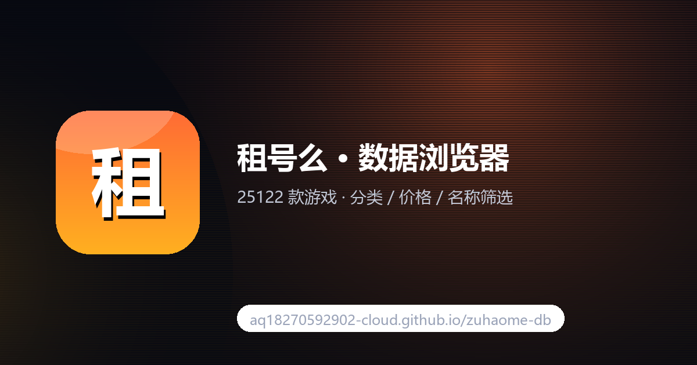

# 租号么 · 公开数据镜像 + 客户端

25280 款游戏的公开数据快照、客户端反编译源码、接口文档，以及一个可搜索的纯前端数据浏览器。

[](https://aq18270592902-cloud.github.io/zuhaome-db/)
[](https://github.com/aq18270592902-cloud/zuhaome-db/releases)
[](./LICENSE)
[](./data/games.slim.json)
[](https://github.com/aq18270592902-cloud/zuhaome-db/stargazers)
[](https://github.com/aq18270592902-cloud/zuhaome-db/commits/main)

**[在线浏览](https://aq18270592902-cloud.github.io/zuhaome-db/)** ·
**[客户端下载](https://github.com/aq18270592902-cloud/zuhaome-db/releases)** ·
**[接口文档](./api/api-endpoints.md)** ·
**[逆向报告](./docs/租号么后台逆向报告.md)**

</div>

---

## 三十秒上手

打开 <https://aq18270592902-cloud.github.io/zuhaome-db/> → 左侧选分类或直接搜名字 → 点「加载更多」翻页。

25280 款游戏，可按分类 / 价格 / 名称 / AppID 筛选，纯前端，数据直接读仓库里的 JSON，没有任何后端。

首屏只下载 `games.index.json`（gzip 后约 9KB，240 款热门游戏 + 统计数字），页面渲染完成后在后台静默拉全量 `games.v2.json`（列式存储，gzip 约 508KB），拉完自动补齐「加载更多」。所以打开就是秒开，不用等 3MB 的 `games.slim.json`。

---

## 界面预览

<table>
<tr>
<td width="50%" align="center">
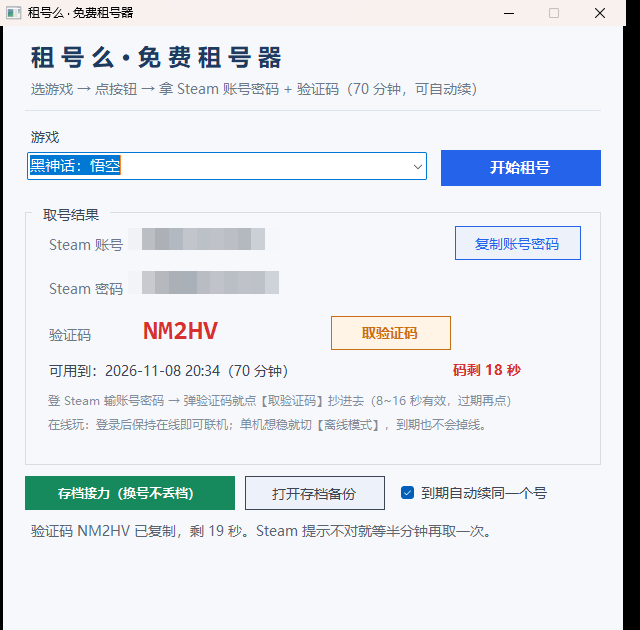<br>
<sub><b>客户端主界面</b> · 选游戏 → 拿到可用账号 → 一键复制</sub>
</td>
<td width="50%" align="center">
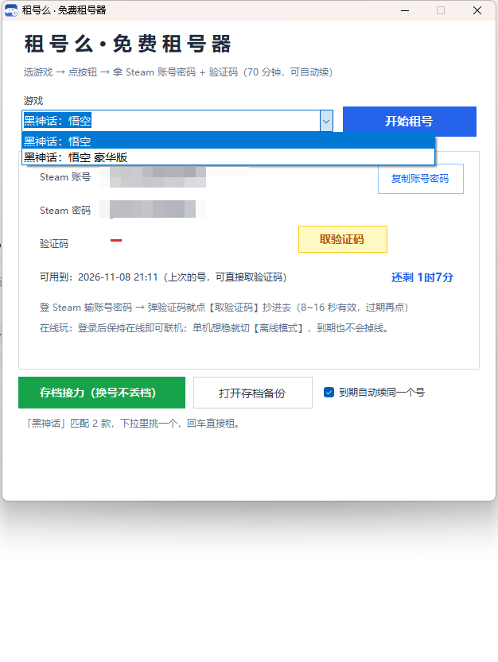<br>
<sub><b>搜索下拉</b> · 输入即出候选，右侧显示时租价</sub>
</td>
</tr>
<tr>
<td width="50%" align="center">
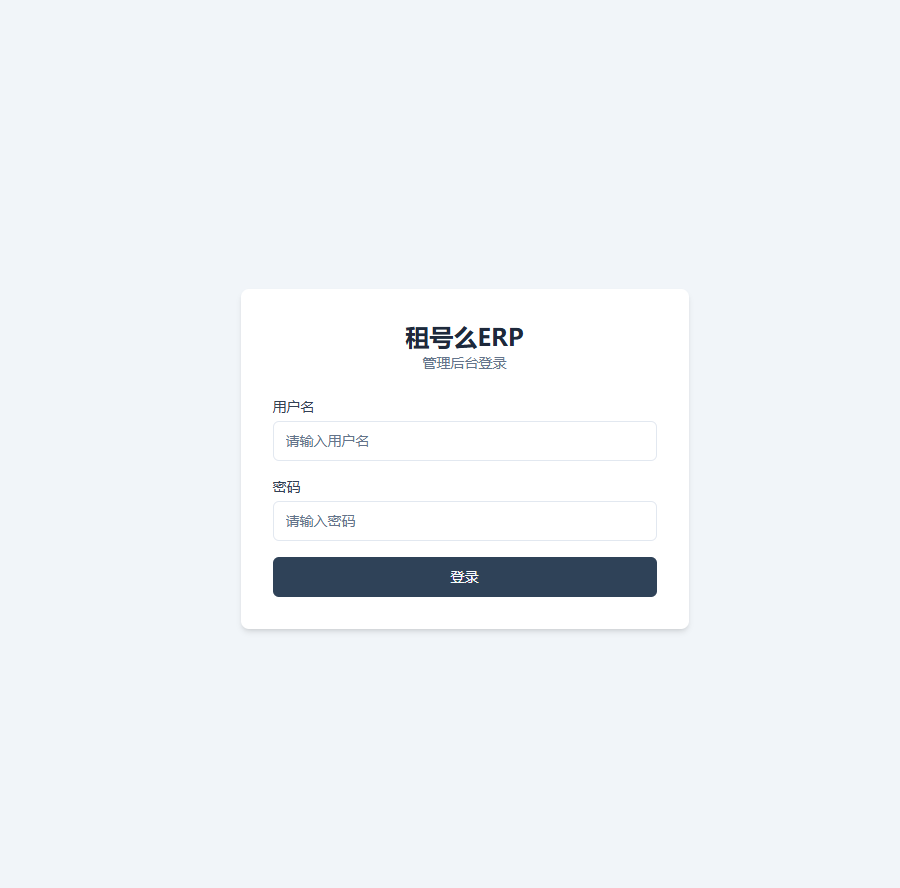<br>
<sub><b>管理后台登录</b> · 逆向出的后台入口</sub>
</td>
<td width="50%" align="center">
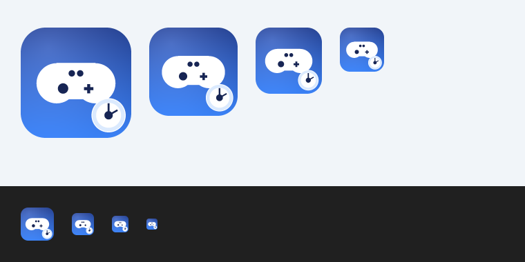<br>
<sub><b>图标多版本对比</b> · 从 exe 资源段提取后重建</sub>
</td>
</tr>
<tr>
<td width="50%" align="center">
<br>
<sub><b>游戏下拉</b> · 25280 款全量检索，右侧显示时租价</sub>
</td>
<td width="50%" align="center">
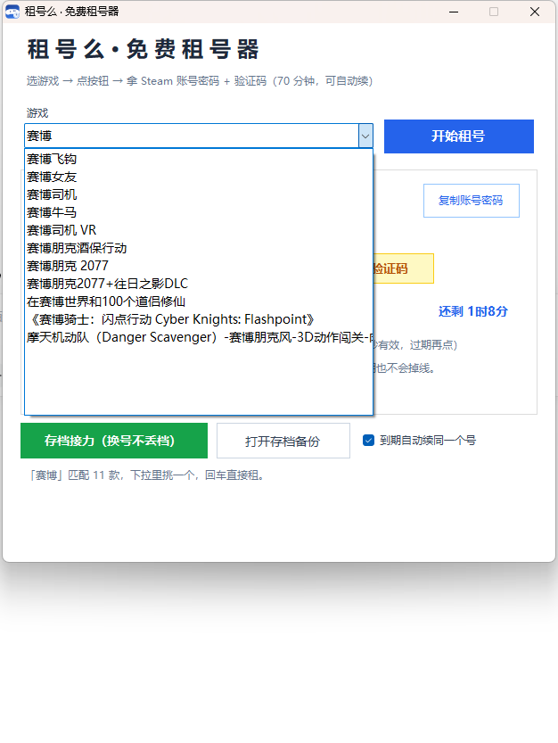<br>
<sub><b>搜索联想</b> · 输入关键词即出候选，含 DLC 与版本标注</sub>
</td>
</tr>
</table>

> 截图里的账号密码已统一打码；原始 exe 与反编译源码在 [`client/`](https://github.com/aq18270592902-cloud/zuhaome-db/tree/main/client) 与 [`src/`](https://github.com/aq18270592902-cloud/zuhaome-db/tree/main/src)。

<details>
<summary><b>展开全部 21 张截图（图标重建过程 + 搜索全过程 + 主界面）</b></summary>

<br>

#### 图标重建：从 exe 资源段提取 → 重建 → 多尺寸导出

<table>
<tr>
<td width="25%" align="center"><br><sub>embedded 32×32 · 从 exe 资源段直接抠出</sub></td>
<td width="25%" align="center"><br><sub>desktop 32×32 · 桌面实际渲染</sub></td>
<td width="25%" align="center"><br><sub>rebuilt 256×256 · 按原图重绘</sub></td>
<td width="25%" align="center"><br><sub>preview 256×256 · 放大对比</sub></td>
</tr>
<tr>
<td width="25%" align="center"><br><sub>v2 256×256 · 圆角+高光版</sub></td>
<td width="25%" align="center"><br><sub>v2 48×48 · 任务栏尺寸</sub></td>
<td width="25%" align="center"><br><sub>sheet · 四版本横排对比</sub></td>
<td width="25%"></td>
</tr>
</table>

#### 搜索与下拉：从空态到命中

<table>
<tr>
<td width="33%" align="center">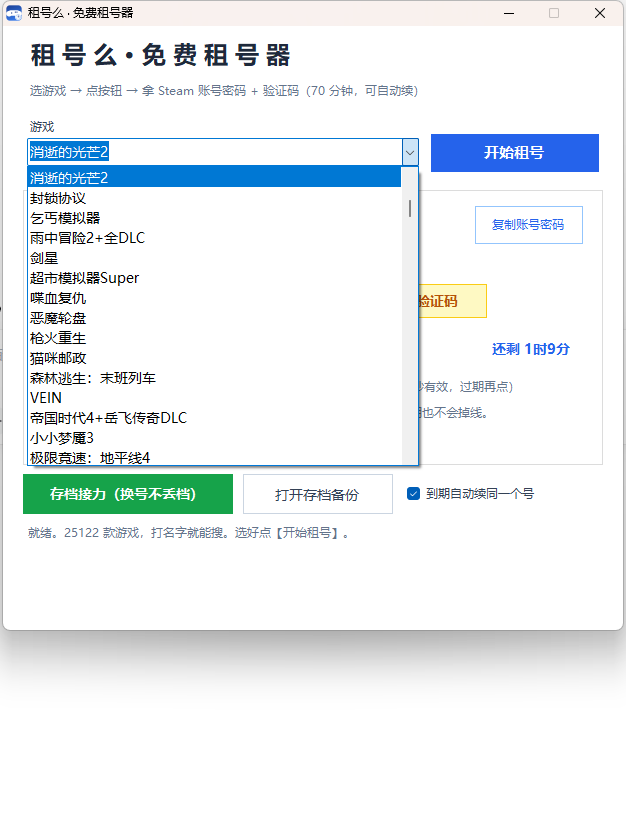<br><sub>空态 · 未输入时</sub></td>
<td width="33%" align="center">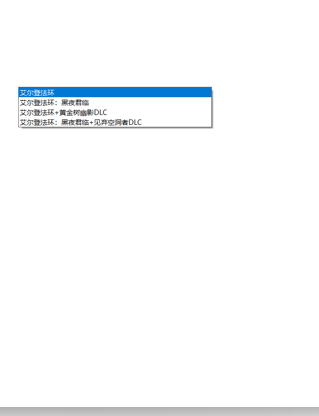<br><sub>输入中 · 候选浮层展开</sub></td>
<td width="33%" align="center">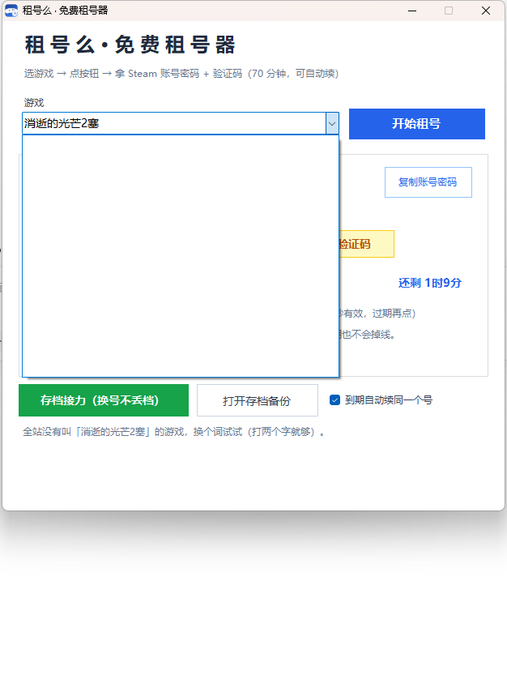<br><sub>关键词「赛」</sub></td>
</tr>
<tr>
<td width="33%" align="center">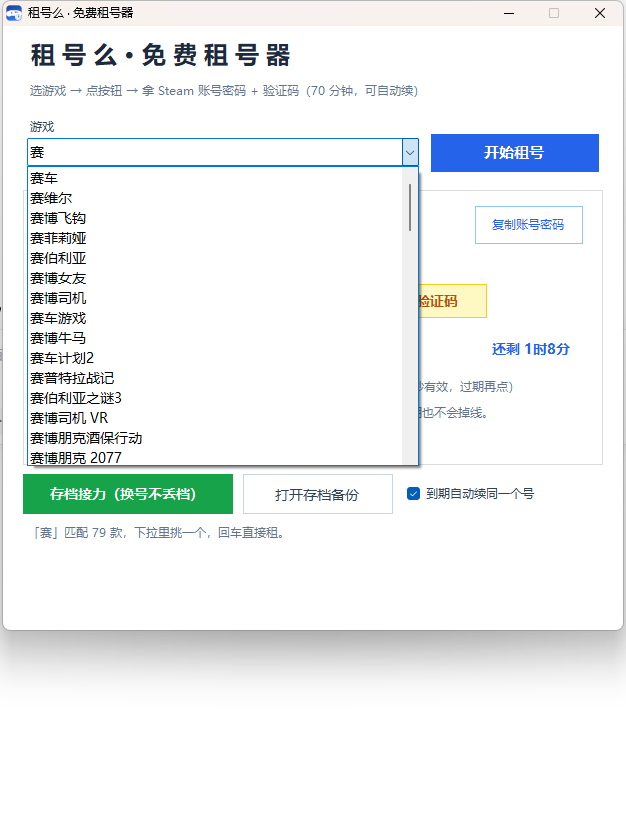<br><sub>关键词「赛」· 另一批候选</sub></td>
<td width="33%" align="center"><br><sub>关键词「赛博」</sub></td>
<td width="33%" align="center">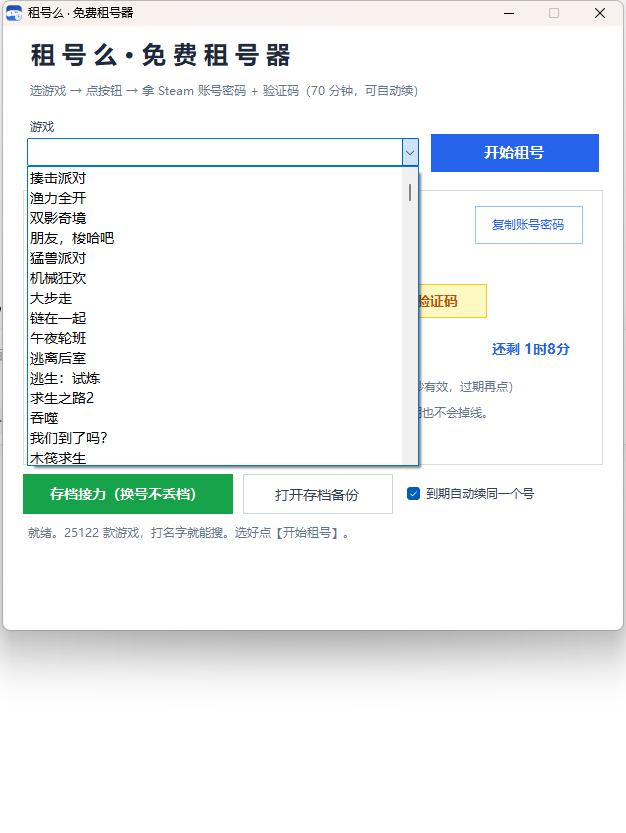<br><sub>热门推荐下拉</sub></td>
</tr>
<tr>
<td width="33%" align="center">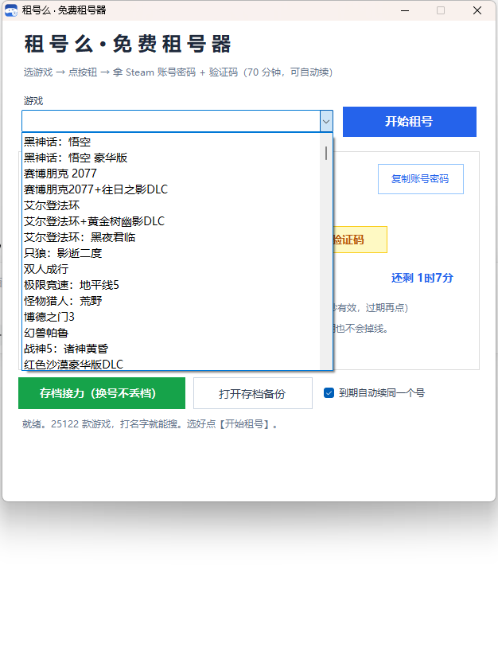<br><sub>热门推荐 · 另一屏</sub></td>
<td width="33%" align="center">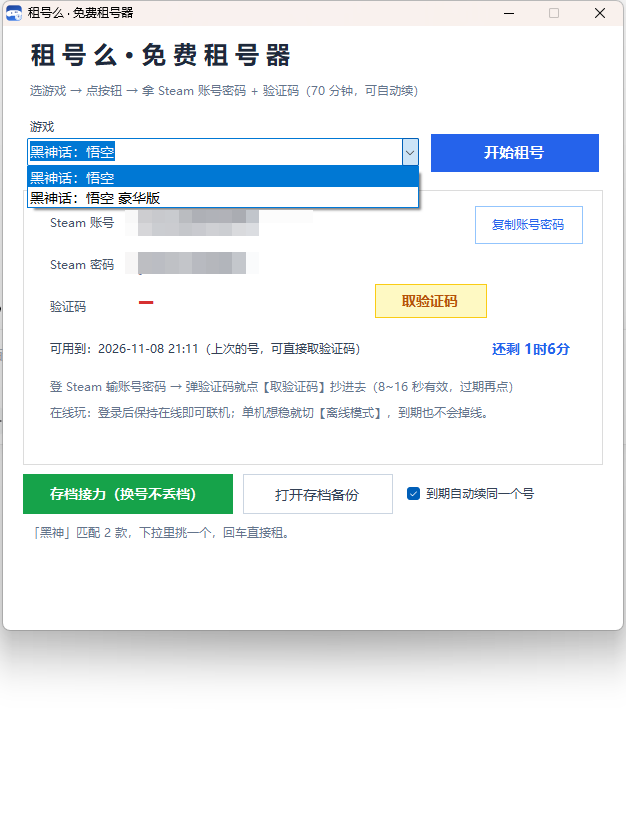<br><sub>默认窗口宽度下的完整界面</sub></td>
<td width="33%" align="center"><br><sub>命中后 · 右侧显示时租价</sub></td>
</tr>
</table>

#### 主界面：四个尺寸版本

<table>
<tr>
<td width="50%" align="center"><br><sub>640×630 · README 主图</sub></td>
<td width="50%" align="center"><br><sub>660×630 · 桌面宽度</sub></td>
</tr>
<tr>
<td width="50%" align="center">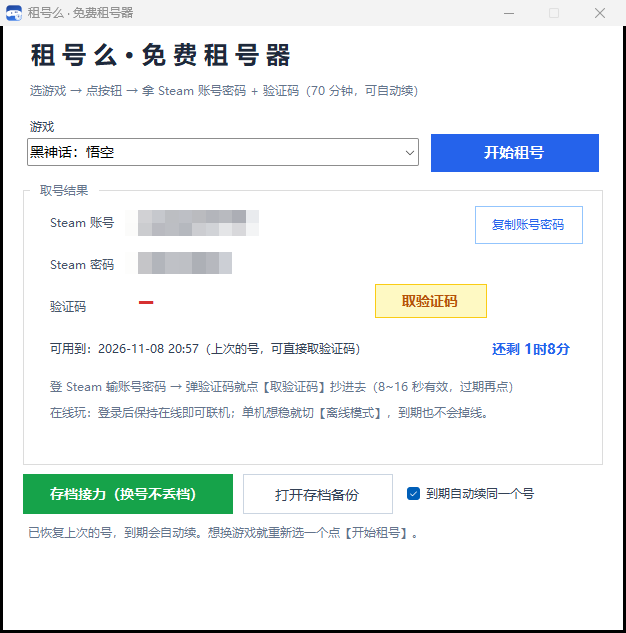<br><sub>626×633 · 窄窗口</sub></td>
<td width="50%" align="center">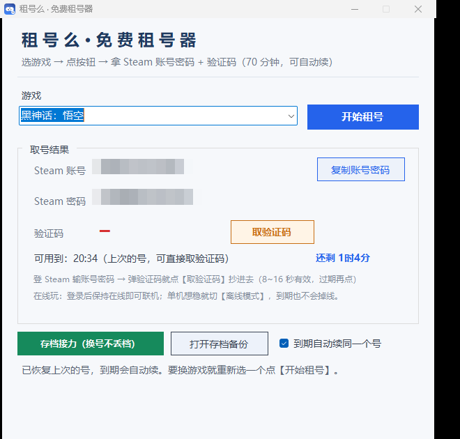<br><sub>660×630 · 图标重建后的主界面</sub></td>
</tr>
</table>

</details>

---

## 仓库结构

```
zuhaome-db/
├── index.html                  数据浏览器（单文件，GitHub Pages 入口）
├── site.webmanifest            PWA 清单
├── 404.html                    自定义错误页
├── assets/                     og.png 分享图 + 4 尺寸图标
├── data/
│   ├── games.index.json        首屏包（240 款 + 统计，30KB，页面先读这个）
│   ├── games.v2.json           全量紧凑包（25280 款，列式 v3，1.3MB，首屏后懒加载）
│   ├── games.slim.json         全量可读版（3MB，回退用 / 第三方引用）
│   ├── games.json.gz           完整原始数据 gzip（1.3MB，解压后 27.6MB，含全部字段）
│   ├── categories.json         20 个分类
│   ├── membership-plans.json   11 个会员套餐（价格单位：分）
│   ├── announcements.json      站内公告
│   ├── faqs.json               常见问题
│   └── client-download.json    客户端下载元信息
├── scripts/
│   ├── refresh-games.js        一键刷新 data/（拉上游全量 + 侧栏，带三道校验闸）
│   └── validate.js             CI 用：校验 SEO 标签 / 本地资源 / JSON 合法性
├── .github/workflows/ci.yml    push 时自动跑 validate.js + node --check
├── api/                        接口清单 / endpoints.json / OpenAPI 导出
├── docs/                       3 份分析报告 + Excel 数据导出
├── src/                        客户端反编译源码（MainForm2.cs 117KB）
├── client/                     官方 exe + games.tsv
├── frontend/                   官网前端资源（55 文件）
└── images/                     21 张截图（裁边重压 + WebP 无损，886KB → 264KB）
    ├── ui-final.webp            客户端主界面（账号密码已打码）
    ├── ui-desktop.webp          主界面 660×630（含游戏下拉）
    ├── search-final.webp        搜索下拉 + 结果态
    ├── search-saibo.webp        搜索「赛博」联想候选
    ├── login.webp               管理后台登录页
    └── icon-sheet.webp         客户端图标多版本对比
```

---

## 数据字段

`games.slim.json` 结构：`{"count": 25280, "games": [...]}`，每项：

```json
{ "i": 14, "n": "揍击派对", "e": "Pummel Party", "a": 880940, "p": 58, "r": 11.6, "c": "联机游戏/动作/休闲/独立", "o": 1 }
```

| 字段 | 含义 |
|---|---|
| `i` | 站内游戏 ID |
| `n` | 中文名 |
| `e` | 英文名 |
| `a` | Steam AppID（5189 款没有） |
| `p` | Steam 售价（元，平均 57.4） |
| `r` | 时租价格（元/小时） |
| `c` | 分类，斜杠分隔 |
| `o` | 是否在线可租（快照里全部为 1） |

### 全量包 `games.v2.json` 是列式存储

文件名沿用 `games.v2.json`，内容其实是第 3 版格式 —— 按列拆开存，省掉 2 万多次重复的键名和重复值：

```json
{ "v": 3, "count": 25280, "c": ["分类串", "…共 1145 个"],
  "i": [站内 ID…], "n": [中文名…], "e": [英文名…], "a": [AppID…],
  "p": [Steam 价…], "r": [时租价…], "ci": [分类下标…] }
```

| 约定 | 说明 |
|---|---|
| `v` | 格式版本。`3` = 列式；老版本 `2`（`g: [[i,n,e,a,p,r,cidx,o], …]` 行式）页面仍能读 |
| `e` 为空串 | 表示英文名与 `n` 相同（25280 款里有 21368 款是这种情况，直接省掉） |
| 没有 `o` 列 | 表示所有游戏都在线（`o` 全为 1 时整列省略），读出来默认 `1` |
| `ci` | 分类在 `c` 数组里的下标，避免 25280 次重复长分类串 |

体积：行式 1813438B → 列式 1307859B，gzip 655055B → **508071B（−22.4%）**。解出来与 `games.slim.json` 逐字段完全相等，`scripts/validate.js` 会校验列长一致、`ci` 不越界。

完整版 `games.json.gz` 里 `CategoryNames` 是数组、`RentPrices` 是 `[{"hours":1,"price":0.3},…,{"hours":24,"price":1.5}]` 这样的阶梯价。

原始包以 gzip 归档（27.6MB → 1.3MB，压缩比 5%）。解压一条命令：

```bash
gunzip -k data/games.json.gz            # 得到 data/games.json，内容与上游逐字节一致
node -e "console.log(require('./data/games.json').data.length)"   # 25280
```

不解压也行，Node 里直接读：

```js
const zlib = require('zlib'), fs = require('fs');
const { data } = JSON.parse(zlib.gunzipSync(fs.readFileSync('data/games.json.gz')));
```

---

## 接口速查

```http
GET https://api.zuhaome.com/api/v1/games?page=1&page_size=20
GET https://api.zuhaome.com/api/v1/categories
GET https://api.zuhaome.com/api/v1/announcements
GET https://api.zuhaome.com/api/v1/faqs
GET https://api.zuhaome.com/api/v1/membership/plans
GET https://api.zuhaome.com/api/v1/client-download
```

游戏图标（可直接热链，无防盗链）：

```
https://api.zuhaome.com/uploads/games/game_appid_{SteamAppID}.jpg
```

**CORS**：`api.zuhaome.com` 返回 `{"error":"CORS origin not allowed"}` 403，**浏览器跨域直连被拒**。所以网页版只能读静态快照，不能做实时查询。要做实时查询得自建后端反代。

---

## 自己重新抓数据

### 推荐：用仓库自带的脚本

```bash
node scripts/refresh-games.js            # 拉全量 + 侧栏，重写 data/ 快照文件
node scripts/refresh-games.js --check    # 只比对，有变化 exit 2（适合挂 CI 定时巡检）
node scripts/refresh-games.js --slim     # 跳过网络，用本地 data/games.json.gz 重建 slim/index/v2
node scripts/refresh-games.js --tsv      # 额外生成 data/games.tsv（628KB，默认不生成）
```

脚本内置三道闸，数据不对就拒绝写盘：条目数 < 1000、ID 非数字、ID 重复。
`data/games.tsv` 是「只写不读」的冗余产物（页面与脚本都不读它），默认不生成，要 grep 时手动加 `--tsv`。
侧栏四个接口（分类 / 公告 / FAQ / 套餐）失败不阻塞主流程，保留旧快照并打日志。
上游响应里的 `server_time` / `refresh_interval_seconds` 每次都会变，写盘前已剥掉，避免无意义 diff。

### 手动：一次请求就是全量

```bash
curl "https://api.zuhaome.com/api/v1/games" \
  -H "accept: application/json" -H "user-agent: Mozilla/5.0" \
  -o games.raw.json
```

**分页参数无效**：`page` / `page_size` / `pageSize` / `limit` 实测全部被忽略，
不管传什么都恒定返回全部 25280 条（约 26.9MB，耗时 40s 左右）。所以不要写分页循环 —— 一次拿完。

响应是 `{"data":[...]}`，34 个字段全留；`scripts/refresh-games.js` 里 `slim()` 负责压成页面用的 8 个字段。

---

## 客户端

`client/租号么免费租号器.exe` 是官方下发版本，也可直接从上游拉：

```
https://api.zuhaome.com/api/v1/client-download/file
```

从源码重编译（`src/`）：

```bat
C:\Windows\Microsoft.NET\Framework64\v4.0.30319\csc.exe /target:winexe /out:租号么.exe MainForm2.cs AssemblyInfo.cs /win32icon:app.ico
```

---

## 本地预览

```bash
python -m http.server 8000
# 打开 http://127.0.0.1:8000/
```

必须用 HTTP 服务打开 —— `file://` 下 `fetch('data/games.slim.json')` 会被同源策略拦掉，页面只剩「数据加载失败」。

---

## 排障

| 现象 | 原因 | 处理 |
|---|---|---|
| 页面提示「数据加载失败」 | 用 `file://` 打开，或 `data/` 目录没上传 | 起 HTTP 服务；确认 `data/games.slim.json` 在 |
| 封面全是 🎮 占位 | `api.zuhaome.com` 的图被网络拦了 | 图片走的是上游热链，与仓库无关；挂代理或忽略 |
| 分类下拉是空的 | `data/categories.json` 结构变了 | 文件根是 `{data:[...]}`，代码两种都兼容，检查是否 404 |
| 「加载更多」点不动 | 已到列表末尾 | 按钮会显示「已显示 N / N」并自动隐藏 |
| 搜不到某个游戏 | 搜索匹配中英文名 / AppID / 站内 ID | 用 AppID 数字搜最准 |

---

## 目录之外的资料

- [`api/api-endpoints.md`](./api/api-endpoints.md) —— 完整接口清单
- [`api/save-openapi.json`](./api/save-openapi.json) —— OpenAPI 3 导出
- [`docs/租号么后台逆向报告.md`](./docs/租号么后台逆向报告.md) —— 后台接口与权限边界
- [`docs/第二阶段-客户端逆向与权限边界报告.md`](./docs/第二阶段-客户端逆向与权限边界报告.md) —— 客户端分析
- [`docs/租号么-公开数据导出.xlsx`](./docs/租号么-公开数据导出.xlsx) —— Excel 版数据

---

## 一句话

25280 款游戏的公开数据全在这个仓库，网页打开就能搜；exe 和反编译源码也在，接口文档在 `api/`。
